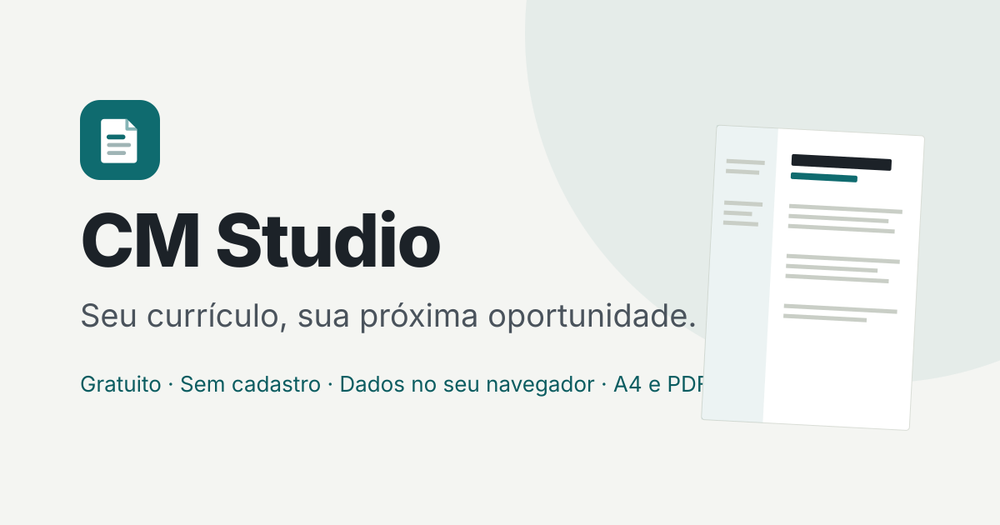

# CM Studio

**CM Studio — Seu currículo, sua próxima oportunidade.**



O CM Studio é um gerador de currículos gratuito que funciona inteiramente no navegador. Você escolhe **para qual país vai se candidatar**, a **finalidade** do documento (emprego, primeiro emprego, estágio, escola, faculdade, pesquisa…) e um **modelo** adequado. Depois, edita com pré-visualização em tempo real no papel certo (A4 ou Letter) e imprime ou salva em PDF pela janela de impressão do próprio navegador.

- Sem cadastro, sem servidor e sem banco de dados externo.
- Os dados ficam **somente no seu navegador** (localStorage).
- Feito com HTML5, CSS3 e JavaScript puro: não há frameworks, dependências nem etapa de compilação.
- Funciona abrindo o `index.html` direto no computador ou publicado no GitHub Pages, inclusive em subpasta.

> **Novidade — atualização internacional.** Além do Brasil, o CM Studio tem perfis para **Estados Unidos, Reino Unido, Canadá, Austrália, Alemanha, França, Portugal, Espanha, Itália, Japão, Irlanda, Países Baixos, Nova Zelândia e Suíça**, e um perfil genérico "Outros países". Cada perfil informa as fontes oficiais consultadas, a data da consulta e o grau de verificação. Currículos criados na versão anterior continuam funcionando: são migrados automaticamente, sem perda de dados.

---

## Sumário

1. [Funcionalidades](#funcionalidades)
2. [País, idioma e finalidade](#país-idioma-e-finalidade)
3. [Países disponíveis e grau de verificação](#países-disponíveis-e-grau-de-verificação)
4. [Papel: A4 e Letter](#papel-a4-e-letter)
5. [Analisador de vaga e assistente de conquistas](#analisador-de-vaga-e-assistente-de-conquistas)
6. [Cartas e documentos complementares](#cartas-e-documentos-complementares)
7. [Foto e dados pessoais](#foto-e-dados-pessoais)
8. [Como usar (início rápido)](#como-usar-início-rápido)
9. [Publicar no GitHub Pages (passo a passo)](#publicar-no-github-pages-passo-a-passo)
10. [Seus dados, backup e migração](#seus-dados-backup-e-migração)
11. [Imprimir e salvar em PDF](#imprimir-e-salvar-em-pdf)
12. [Como adicionar país, idioma ou modelo](#como-adicionar-país-idioma-ou-modelo)
13. [Estrutura de pastas](#estrutura-de-pastas)
14. [Arquitetura](#arquitetura)
15. [Testes](#testes)
16. [Acessibilidade e segurança](#acessibilidade-e-segurança)
17. [Limitações conhecidas](#limitações-conhecidas)
18. [Fontes (datadas)](#fontes-datadas)
19. [Licença](#licença)

---

## Funcionalidades

### Telas
- **Início:** apresentação, atalhos por país ("Para onde é a sua candidatura?"), currículos recentes (com o país de cada um), galeria com os 14 modelos, finalidades e dicas.
- **Criar currículo:** assistente em 4 etapas.
  1. **País:** com busca e países mais usados.
  2. **Finalidade.**
  3. **Modelo:** com pré-visualização.
  4. **Detalhes:** idioma, papel e nome.
- **Editor:** formulário à esquerda e pré-visualização em tempo real à direita. No celular, as abas "Editar" e "Visualizar" alternam entre os dois.
  - A **barra de contexto** mostra, e permite trocar a qualquer momento: país, idioma, finalidade, modelo, papel e avisos.
  - **Abas:** Conteúdo, Design, Revisão, Vaga e Cartas.
- **Meus currículos:** criar, abrir, renomear, duplicar, exportar, excluir (com confirmação), buscar e ordenar. Cada linha mostra a bandeira, o nome do país e o idioma.
- **Configurações:** tema claro, escuro ou automático; **país de destino padrão**; opção de sugerir o último país usado; preferências do editor; backup; apagar todos os dados.
- **Ajuda:** inclui a tabela **Países e perfis** (status, idiomas, papel, foto e fontes), o analisador de vaga, as cartas, impressão, backup, ATS e atalhos.

### 12 finalidades
Currículo profissional · Primeiro emprego · Estágio · Jovem aprendiz (só Brasil) · Escolar / estudantil · Faculdade / processo seletivo acadêmico · Bolsa de estudos · Pesquisa acadêmica · Intercâmbio · Voluntariado · Acadêmico estendido · Personalizado.

**Admissão em faculdade é diferente de candidatura a emprego**: nos EUA, por exemplo, a finalidade "Faculdade" usa um résumé curto, enquanto "Pesquisa acadêmica" usa um CV acadêmico sem limite fixo de páginas.

### 14 modelos
Clássico · Minimalista · Corporativo · Moderno · Acadêmico · Escolar / estudantil · Primeiro emprego · ATS (leitura automatizada) · Acadêmico estendido · **Résumé norte-americano** · **Lebenslauf tabular** · **Estilo Europass** · **履歴書 (rirekisho)** · **職務経歴書 (shokumu keirekisho)**.

Os modelos são independentes dos países e mudam de fato a estrutura do documento:
- O Lebenslauf e o Estilo Europass têm um bloco de dados pessoais em tabela.
- O 履歴書 tem um renderizador próprio, com a tabela 年/月 de formação e carreira.
- O 職務経歴書 é organizado por empresa.

O assistente e a aba Design mostram primeiro os modelos **recomendados** para o país e a finalidade. Os demais ficam disponíveis em "mostrar todos".

> O modelo **Estilo Europass** é apenas *inspirado* na estrutura do Europass. Ele não é o editor oficial da União Europeia, e o Europass é sempre uma opção, nunca uma exigência.

### Editor (mantido da versão anterior)
- Pré-visualização em tempo real e salvamento automático.
- Desfazer e refazer (até 100 passos).
- Adicionar, remover, duplicar, ocultar e reordenar seções e itens.
- Validação de e-mail, telefone e links.
- Contagem de páginas e aba Revisão.
- Navegação completa por teclado.
- Sugestões de texto locais. Os exemplos estão em português; em documentos de outro idioma, o app avisa que não traduz automaticamente.

| Atalho | Ação |
|---|---|
| Ctrl/⌘ + Z | Desfazer |
| Ctrl/⌘ + Shift + Z ou Ctrl/⌘ + Y | Refazer |
| Ctrl/⌘ + S | Salvar agora |
| Ctrl/⌘ + P | Imprimir / salvar como PDF |
| ← / → / Home / End (nas abas) | Trocar de aba |

---

## País, idioma e finalidade

São três escolhas **independentes**:

- **País de destino:** onde você vai se candidatar, **não a sua nacionalidade**. O Brasil é o padrão. O país ajusta:
  - o idioma sugerido, o papel e os modelos recomendados;
  - as seções e os títulos;
  - quais dados pessoais aparecem no formulário;
  - a orientação sobre foto, os formatos de data e de telefone e o limite de páginas;
  - a terminologia (CV, résumé, Lebenslauf…), as dicas, os avisos e as cartas sugeridas.
- **Idioma do documento:** pode ser diferente do país. Por exemplo, um currículo para a Alemanha em inglês, ou para Portugal em português europeu. O CM Studio traduz **apenas títulos e rótulos**, nunca o texto que você escreveu.
- **Finalidade:** define as seções iniciais e as orientações.

**Trocar qualquer uma delas preserva todos os dados.**
- Antes de aplicar, o diálogo explica o que vai mudar.
- Títulos personalizados por você são mantidos.
- Campos desaconselhados no novo país **não são apagados**: a Revisão avisa e você decide.

**Regras de texto que o app segue:**
- Nomes de instituições, cursos e diplomas **não são traduzidos**. Se quiser, acrescente uma tradução entre parênteses.
- O app **não afirma equivalência** de diplomas entre países.
- Quando a tradução de rótulos de um idioma está incompleta, a Revisão avisa. Hoje, os 18 idiomas estão completos.

Idiomas de documento: Português (Brasil), Português (Portugal), Inglês (EUA, Reino Unido, Canadá, Austrália, Irlanda, Nova Zelândia), Alemão (Alemanha, Suíça), Francês (França, Canadá, Suíça), Espanhol (Espanha), Italiano (Itália, Suíça), Neerlandês e Japonês.

---

## Países disponíveis e grau de verificação

| Status | Países |
|---|---|
| **Verificado** em fonte oficial ou institucional (15/10/2026) | Estados Unidos, Reino Unido, Canadá, Austrália (fonte do Governo de Queensland), Alemanha, França, Portugal, Espanha, Itália, Japão, Irlanda, Nova Zelândia, Suíça |
| **Parcial** | Brasil (não há guia federal sobre formato de currículo; foram usadas uma fonte do Ministério do Trabalho e outra da Prefeitura de São Paulo) |
| **Preliminar** | Países Baixos (só foi obtida fonte municipal) |
| **Genérico** | Outros países (modelo neutro, sem verificação) |

"Verificado" significa que as orientações principais vêm de uma fonte citada. Pontos que a fonte não cobre aparecem no próprio app como "não verificado". Espanha, Itália, Irlanda, Nova Zelândia e Suíça têm perfis mais curtos, com uma única fonte cada.

Detalhes, tabela completa e fontes por país: **[docs/PERFIS-NACIONAIS.md](docs/PERFIS-NACIONAIS.md)** e **[docs/FONTES-PESQUISA.md](docs/FONTES-PESQUISA.md)**.

> Orientações de currículo são **convenções, não leis**. Quando a vaga, a empresa ou a instituição pedir algo diferente, siga a vaga.

---

## Papel: A4 e Letter

- O padrão é **Letter** (216 × 279 mm) nos EUA e no Canadá, e **A4** (210 × 297 mm) nos demais países.
- Você pode trocar o papel em qualquer documento: na barra de contexto, opção **Papel**.
- Se o papel diferir do padrão do país, a Revisão avisa.
- A pré-visualização é proporcional ao papel escolhido.
- A impressão usa `@page` com o tamanho correto e a mesma paginação da pré-visualização. O teste automatizado confere que o PDF tem o mesmo número de páginas da prévia, nos dois formatos.

---

## Analisador de vaga e assistente de conquistas

**Analisador de vaga** (aba **Vaga**):
- Cole o texto do anúncio. O app identifica os termos frequentes, inclusive compostos como "Power BI" ou "Atendimento ao cliente", e mostra quais **já aparecem** no seu currículo e quais **estão ausentes**.
- Para cada termo ausente, você escolhe: **Tenho isso**, **Editar** ou **Ignorar**.
- Só depois de aceitar um termo aparece o botão "Adicionar a Competências". Nada é incluído sem o seu clique.
- O **resumo das alterações** mostra o que foi adicionado, aceito, editado e ignorado.

Limites do analisador:
- Funciona **100% no navegador**, sem internet e sem inteligência artificial.
- **Não é uma nota nem uma previsão de aprovação**, e não garante aprovação em sistemas ATS. Ele apenas compara palavras.
- Não inventa habilidades: inclua um termo somente se ele for verdadeiro para você.

**Assistente de conquistas:** ajuda a montar uma frase no formato *ação + o quê + como + resultado*. O campo de número é opcional. O assistente **nunca cria números**: se você não informar, a frase fica sem número.

---

## Cartas e documentos complementares

Na aba **Cartas** você cria, separadamente do currículo:
- carta de apresentação (cover letter), *lettre de motivation*, *Anschreiben* e carta de apresentação ou motivação;
- resumo de projeto, lista de publicações, portfólio;
- folha de referências e resposta a critérios de seleção (Austrália).

Cada documento:
- tem **editor, idioma e orientações próprios**;
- usa a saudação e o fecho do idioma escolhido;
- é paginado e impresso **separadamente**;
- **nunca é misturado ao currículo**.

O app sugere os documentos mais comuns para o país, como o Anschreiben na Alemanha. No Japão, a fonte consultada informa que a carta de apresentação não é exigida.

---

## Foto e dados pessoais

- A foto **nunca é obrigatória**. Ela começa desativada e só aparece nos modelos que têm espaço para ela (Lebenslauf, Estilo Europass e 履歴書).
- A orientação de foto de cada país indica se vem da fonte ou se é só uma prática comum não verificada.
- A imagem é reduzida e guardada no próprio navegador. São aceitos apenas PNG, JPEG e WebP.
- **Dados sensíveis ficam ocultos por padrão:** data de nascimento, nacionalidade, endereço completo, permissão de trabalho e habilitação. Eles só aparecem quando o país os considera opcionais ou recomendados, ou quando você clica em "Mostrar outros campos".
- Se você preencher um dado desaconselhado para o país, a Revisão avisa.
- **Japão:** o app não pede nacionalidade, religião, dados da família nem conta bancária. Ele também lembra que empresas japonesas podem exigir formulário próprio.
- **Brasil:** não são pedidos foto, idade, estado civil, CPF, RG nem endereço completo. O app não substitui o Currículo Lattes.

---

## Como usar (início rápido)

1. Baixe e descompacte o arquivo `CM-Studio-Internacional-Atualizado.zip`.
2. Abra a pasta `CM-Studio` e dê dois cliques em **`index.html`**.
3. Clique em **Criar currículo** e siga as etapas:
   - **país** (onde você vai se candidatar);
   - **finalidade**;
   - **modelo**;
   - **detalhes** (idioma, papel e nome).
4. Preencha os campos. A pré-visualização é atualizada enquanto você digita, e tudo é salvo automaticamente.
5. Confira a aba **Revisão**. Se quiser, use as abas **Vaga** e **Cartas**.
6. Clique em **PDF** ("Imprimir / Salvar como PDF").
7. De vez em quando, exporte um **backup** em *Configurações → Exportar backup*.

Navegadores recomendados: versões atuais do Chrome, Edge, Firefox ou Safari.

---

## Publicar no GitHub Pages (passo a passo)

1. **Crie uma conta** em [github.com](https://github.com), se ainda não tiver.
2. **Crie um repositório:** clique em **New repository**, dê um nome (por exemplo, `cm-studio`), marque **Public** e clique em **Create repository**.
3. **Envie os arquivos:**
   - Clique em **Add file → Upload files**.
   - Arraste **o conteúdo da pasta `CM-Studio`**: `index.html`, as pastas `css`, `js`, `assets`, `docs` e `tests`, além de `README.md` e `LICENSE`.
   - O `index.html` precisa ficar na **raiz** do repositório.
   - Clique em **Commit changes**.
4. **Ative o Pages:**
   - Vá em **Settings → Pages**.
   - Em **Source**, escolha **Deploy from a branch**.
   - Em **Branch**, selecione **`main`** e a pasta **`/ (root)`**, e clique em **Save**.
5. Aguarde alguns minutos. O endereço publicado aparece em **Settings → Pages**, normalmente no formato `https://SEU-USUARIO.github.io/NOME-DO-REPOSITORIO/`.

Pela linha de comando, dentro da pasta `CM-Studio`:

```bash
git init
git add .
git commit -m "CM Studio — atualização internacional"
git branch -M main
git remote add origin https://github.com/SEU-USUARIO/NOME-DO-REPOSITORIO.git
git push -u origin main
```

**Já publicou a versão anterior?** Substitua os arquivos do repositório pelos desta versão, incluindo as novas pastas `js/countries`, `js/i18n`, `js/renderers` e `docs`. Os currículos dos usuários ficam no navegador de cada um e são migrados automaticamente na primeira abertura.

**Observações:**
- Todos os caminhos são relativos (o teste automatizado confere isso), então o app funciona em subpastas como `/NOME-DO-REPOSITORIO/`.
- Os dados ficam ligados ao endereço. Currículos criados ao abrir o `index.html` localmente não aparecem na versão publicada. Para levá-los, use **exportar/importar backup**.

---

## Seus dados, backup e migração

- Cada currículo é salvo separadamente no `localStorage`, com chaves que começam com `cmstudio.v1.`. O prefixo foi mantido por compatibilidade.
- **Não existe nuvem nem sincronização.** Limpar os dados de navegação, usar modo anônimo ou trocar de navegador apaga ou esconde os currículos. Faça backups.
- **Exportar backup:** gera um `.json` com todos os currículos, incluindo país, idioma, papel, cartas e análise de vaga.
- **Importar backup:**
  - É feita validação (até 5 MB e 500 currículos; campos desconhecidos são descartados; fotos são validadas).
  - Você pode **mesclar** ou **substituir**. Substituir pede confirmação.
  - Backups da versão anterior também são aceitos.

**Migração automática (schemaVersion 1 → 2):**
- Ao abrir um currículo da versão anterior, o app o converte para o novo formato, com:
  - país **Brasil**, idioma **pt-BR** e papel **A4**;
  - os títulos de seção, os textos e a ordem preservados.
- Uma **cópia do original** é guardada (chave `cmstudio.v1.legacy.<id>`).
- Nenhum documento é apagado na migração.

---

## Imprimir e salvar em PDF

O botão **PDF** abre a janela de impressão do navegador (`window.print()`). O app **não gera o PDF diretamente**: quem cria o arquivo é o navegador.

1. Em **Destino**, escolha **Salvar como PDF**.
2. Confira se o tamanho do papel é o do documento (**A4** ou **Letter**; aparece na barra do editor) e se a escala está em 100%.
3. Use margens **Padrão** ou **Nenhuma** e desative **Cabeçalhos e rodapés**.

O nome sugerido do arquivo segue o modelo e o idioma, por exemplo `ana-silva-curriculo`, `jordan-example-resume` ou `lena-beispiel-lebenslauf`. Cartas são impressas separadamente, pelo botão da aba Cartas.

---

## Como adicionar país, idioma ou modelo

**Novo país**
1. Copie um perfil parecido em `js/countries/` (por exemplo, `ie.js`) para `js/countries/<código>.js`.
2. Ajuste `code`, `name`, `localName`, `languages`, `paper`, `photo`, `fields` (política de cada dado pessoal: `recommended`, `optional`, `discouraged` ou `hidden`), `templates`, `purposes`, `tips` e `warnings`.
3. Em `sources`, liste **apenas páginas que você realmente consultou**, com `title`, `publisher`, `url` (https), `accessed` (AAAA-MM-DD) e `supports`.
4. Defina `status` (`verified`, `partial`, `preliminary` ou `generic`), `verifiedAt` e `statusNote` (o que *não* foi verificado).
5. Inclua `<script src="js/countries/<código>.js"></script>` no `index.html` e em `tests/unit-tests.html`, logo depois dos outros perfis.
6. Rode os testes. Eles conferem os campos obrigatórios, as datas, os links https e a ausência de percentuais.

**Novo idioma**
1. Para uma variante regional, use `CM.i18n.derive('xx-YY', 'xx-ZZ', { ... })`, como em `js/i18n/en-variants.js`.
2. Para um idioma novo, copie `js/i18n/en-US.js` e traduza `labels`, `titles`, `docTitles`, `levels`, `months` e `letter`.
3. Inclua o arquivo no `index.html` e em `tests/unit-tests.html`.
4. Confira em `CM.i18n.completeness('<código>')`: o teste exige `document: 'full'`.

**Novo modelo**
1. Registre o modelo em `js/templates.js`, com `id`, `name`, `layout`, `countries` (ou `null` para todos) e opções como `personalBlock` ou `photoSlot`.
2. Escreva o CSS em `css/templates-intl.css`, usando a classe `.tpl-<id>`.
3. Para estruturas muito diferentes, crie um renderizador em `js/renderers/`, como os dois japoneses.
4. Acrescente dados fictícios em `js/samples.js`, para a miniatura.

---

## Estrutura de pastas

```
CM-Studio/
├── index.html                # Estrutura do app, ícones SVG e ordem dos scripts
├── README.md · LICENSE
├── docs/
│   ├── PERFIS-NACIONAIS.md   # Tabela e detalhes dos 16 perfis
│   └── FONTES-PESQUISA.md    # Fontes consultadas, não consultadas e lacunas
├── assets/                   # Ícones e capa
├── css/
│   ├── tokens.css · base.css · layout.css · components.css
│   ├── home.css · editor.css · responsive.css · print.css
│   ├── templates.css         # 9 modelos de base (A4 e Letter)
│   ├── templates-intl.css    # Résumé, Lebenslauf, Europass, 履歴書, 職務経歴書
│   └── countries.css         # Seletor de país, barra de contexto, foto, vaga, cartas
├── js/
│   ├── utils.js · ui.js · storage.js · state.js · validation.js
│   ├── catalog.js            # Finalidades, seções e modelo de dados (v2)
│   ├── i18n/                 # registry + 18 idiomas (pt-BR é a referência)
│   ├── localization.js       # Rótulos, datas, títulos de seção por idioma
│   ├── countries/            # registry + 16 perfis declarativos (br, us, uk, …, other)
│   ├── country-rules.js      # Regras centralizadas (modelos, papel, campos, avisos)
│   ├── templates.js · preview.js · print.js · samples.js · suggestions.js
│   ├── renderers/            # jp-rirekisho.js, jp-shokumu.js
│   ├── flags.js              # Bandeiras em SVG (complementares ao nome)
│   ├── country-selector.js   # Seletor de país, detalhes do perfil, tabela da ajuda
│   ├── new-document.js       # Assistente em 4 etapas
│   ├── editor.js · editor-context.js · photo.js
│   ├── job-analyzer.js · job-panel.js · writing-assistant.js
│   ├── letters.js · letters-ui.js
│   ├── export-import.js · home.js · library.js · settings.js
│   └── app.js                # Rotas e inicialização
└── tests/
    ├── unit-tests.html · unit-tests.js   # 37 testes — abra no navegador
    └── e2e/e2e_test.py                   # 156 verificações com Playwright (opcional)
```

---

## Arquitetura

- **Sem build:** scripts clássicos no namespace `window.CM`, carregados em ordem pelo `index.html`. Isso funciona em `file://`, o que módulos ES não permitem.
- **Perfis declarativos:** cada país é um objeto de dados em `js/countries/`, separado do editor. Toda decisão por país passa por `js/country-rules.js`, que define modelos recomendados, papel, política de campos, foto, idiomas, limite de páginas, títulos e avisos da revisão.
- **Modelos separados dos países:** um modelo declara em quais países faz sentido, mas pode ser usado em qualquer um. A Revisão avisa quando o modelo é específico de outro país.
- **Rotas por hash:** `#/inicio`, `#/novo?pais=&tipo=&modelo=`, `#/editor/<id>`, `#/biblioteca`, `#/configuracoes`, `#/ajuda[/tópico]`.
- **Modelo de dados v2:** além dos dados da versão 1, cada currículo guarda `country`, `locale`, `region`, `design.paper`, `design.showPhoto`, `personal.photo`, campos pessoais extras, `companions[]` (cartas) e `job` (análise de vaga). Cada seção guarda um `titleKey`, que permite traduzir os títulos padrão sem tocar nos personalizados.
- **Renderização única:** o mesmo código gera a pré-visualização, as miniaturas e a impressão.

---

## Testes

**Executados nesta versão (15/10/2026, Chromium via Playwright):**

| Conjunto | Resultado |
|---|---|
| Testes unitários (`tests/unit-tests.html`) | **37 de 37** aprovados |
| Teste ponta a ponta (`tests/e2e/e2e_test.py`) | **156 de 156** verificações aprovadas, já incluindo a execução dos testes unitários |

**O teste ponta a ponta cobre os fluxos da versão anterior:**
- edição, itens, sugestões, seções e desfazer/refazer;
- os 14 modelos, salvamento automático, biblioteca, backup, impressão, celular e temas.

**E os fluxos internacionais:**
- **Criação e perfis:**
  - tela de país (busca, 16 opções com nome por extenso, status preliminar);
  - Brasil profissional e escolar;
  - résumé e CV acadêmico dos EUA (Letter), e admissão universitária com résumé;
  - Reino Unido (A4, data de nascimento oculta e aviso ao preencher);
  - Alemanha (Lebenslauf, foto opcional, Anschreiben impresso em 1 página A4);
  - Japão (履歴書 ↔ 職務経歴書, sem campos indevidos).
- **Trocas e papel:**
  - troca de país, idioma e papel com dados idênticos;
  - prévia proporcional em A4 e Letter, e aviso de papel;
  - PDF com o mesmo número de páginas da prévia, inclusive em documento com várias páginas.
- **Ferramentas e dados:**
  - analisador de vaga (aceitar, ignorar, adicionar, resumo);
  - migração de um documento v1 pela biblioteca.
- **Ajuda e configurações:**
  - tabela de perfis com rótulos de suporte e links das fontes;
  - país padrão nas configurações e atalhos de país na página inicial.
- **Qualidade:**
  - caminhos relativos e arquivos existentes;
  - **nenhum botão ou link visível sem ação**, verificado nos *event listeners* via DevTools Protocol;
  - celular a 390 px sem rolagem horizontal;
  - contraste dos cartões de país nos temas claro e escuro;
  - nenhum erro de JavaScript no console.

**Os testes unitários cobrem:**
- **Perfis e fontes:**
  - os 16 perfis com status, datas e fontes bem formadas;
  - ausência das fontes **não consultadas** e de percentuais nos perfis.
- **Regras e trocas:**
  - regras por país (papel, foto, idioma, campos, modelo inicial);
  - migração v1 → v2 (incluindo a cópia do original);
  - troca BR → EUA → JP → BR sem perda de dados;
  - idioma independente do país e A4 ↔ Letter.
- **Documentos e ferramentas:**
  - estruturas distintas do 履歴書 e do 職務経歴書;
  - analisador e assistente sem invenção;
  - cartas separadas do currículo e foto segura;
  - completude dos 18 idiomas.

**Como rodar:**

```bash
# Unitários: basta abrir tests/unit-tests.html no navegador.
# Ponta a ponta (opcional):
pip install playwright pymupdf
python -m playwright install chromium
python tests/e2e/e2e_test.py
```

Capturas de tela e PDFs gerados ficam na pasta temporária do sistema (`cm-studio-e2e`).

**Verificado por inspeção (não por teste automatizado):**
- o conteúdo das orientações de cada país em relação às fontes;
- a aparência dos modelos nas capturas de tela;
- a impressão real numa impressora física. Os testes geram o PDF pelo Chromium; outros navegadores podem variar levemente.

---

## Acessibilidade e segurança

- Navegação completa por teclado, foco visível, rótulos em todos os campos e diálogos nativos (`<dialog>`).
- As bandeiras são sempre complementares: todo país aparece com o **nome por extenso** (e o nome local), e a busca aceita nome, nome local e idioma.
- Todo texto do usuário é inserido com `textContent`. Os links são validados (apenas `http`, `https` e `mailto`). A foto só é aceita como imagem PNG, JPEG ou WebP. Backups são validados e sanitizados.
- O analisador de vaga e o restante do app funcionam sem rede. Não há rastreamento, cookies nem recursos externos.

---

## Limitações conhecidas

- **Orientações por país são convenções**, verificadas em fontes datadas de 15/10/2026, e podem mudar. Brasil é **parcial**, Países Baixos é **preliminar** e "Outros países" é **genérico**. Veja as lacunas em [docs/FONTES-PESQUISA.md](docs/FONTES-PESQUISA.md).
- **Tradução:** o app traduz títulos e rótulos, não o seu texto. As sugestões de frases existem apenas em português.
- **Japão:** os modelos 履歴書 e 職務経歴書 seguem a estrutura descrita pelas fontes, mas não substituem formulários próprios que empresas podem exigir. O calendário japonês (和暦) não é convertido; as datas usam o calendário ocidental.
- **PDF via navegador:** o resultado depende das opções da janela de impressão. A contagem de páginas pode variar levemente entre navegadores.
- **ATS:** os modelos seguem boas práticas, mas **não há garantia** de aprovação nem de compatibilidade com todos os sistemas.
- **Analisador de vaga:** compara palavras. Não entende sinônimos nem contexto, e não é uma nota.
- **Armazenamento:** o `localStorage` costuma ter cerca de 5 MB por site. Fotos ocupam espaço (o app as reduz). Faça backups.

---

## Fontes (datadas)

Todas foram consultadas em **15/10/2026**. A lista completa, com o que cada fonte embasa, está em [docs/FONTES-PESQUISA.md](docs/FONTES-PESQUISA.md).

- **EUA:** Harvard FAS Mignone Center (*Create a Strong Resume* e *GSAS CV & Cover Letter Guide*). É uma fonte institucional, não governamental.
- **Reino Unido:** National Careers Service (*CV sections*).
- **Canadá:** Job Bank (*How to write a good resume*).
- **Austrália:** Queensland Government (*Write a resume*).
- **Alemanha:** Make it in Germany (*Applying for a job in Germany*).
- **França:** Service-Public.fr (F33336).
- **Portugal, Espanha e Itália:** EURES (*Living and working conditions*).
- **Japão:** Hello Work/MHLW (*応募書類の作成*) e Tokyo Career Guide (Step 1).
- **Irlanda:** JobsIreland (*Tips and Advice*).
- **Países Baixos:** Krimpenwijzer (fonte municipal).
- **Nova Zelândia:** Tahatū Career Navigator (*How to write a CV*).
- **Suíça:** arbeit.swiss (SECO).
- **Brasil:** Ministério do Trabalho e Emprego (aprendizagem profissional) e Prefeitura de São Paulo/SMDET (*Como preparar um currículo*).

**Não consultadas** (e, portanto, não citadas nos perfis): arbeitsagentur.de, usa.gov, a página de criação de CV do Europass e a raiz do gov.br.

---

## Licença

Distribuído sob a licença MIT. Veja o arquivo [LICENSE](LICENSE).
